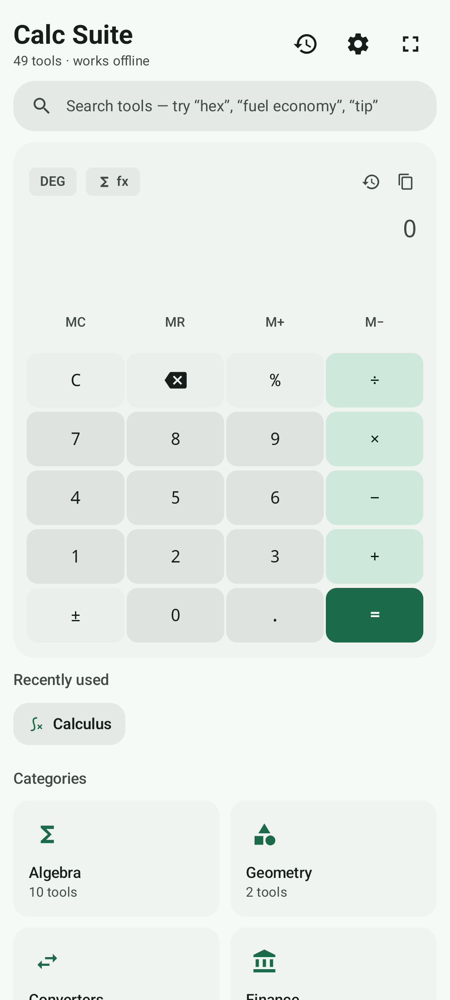
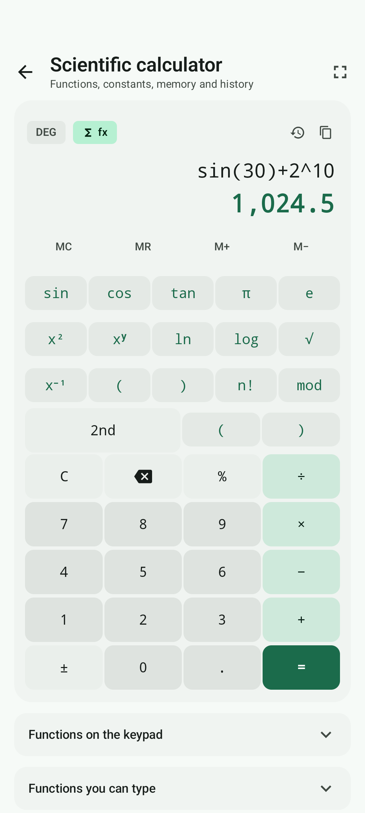
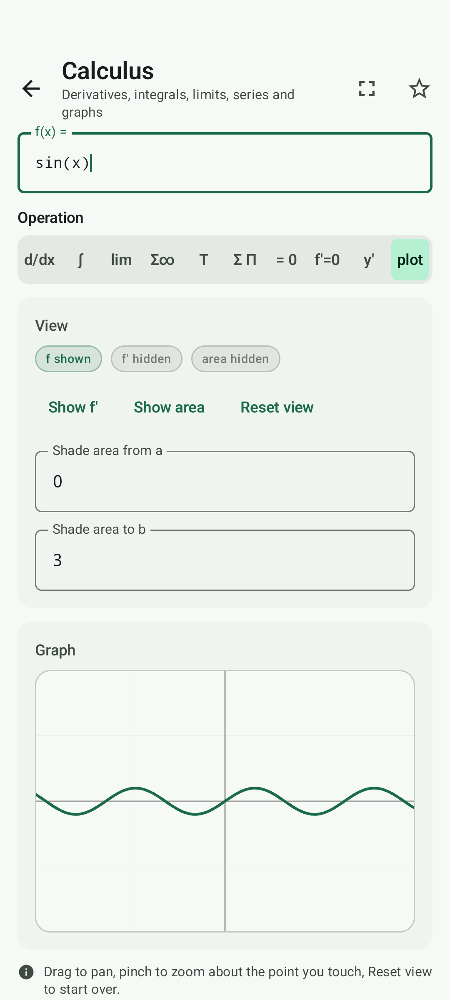

<div align="center">

# Calculator Suite

**66 calculators in one Android app — a fast everyday keypad, a full calculus workbench, an electrical circuit editor, and an AI that reads a photograph of a problem.**

[](https://developer.android.com)
[](https://developer.android.com/about/versions/oreo)
[](https://developer.android.com/about/versions/16)
[](https://kotlinlang.org)
[](https://developer.android.com/jetpack/compose)
[](docs/BUILDING.md)
[](LICENSE)

</div>

## Screenshots

These images are from an earlier release (3.0-era) and may differ in detail from 3.1.0.

| Main menu | Scientific calculator | Calculus graph |
|---|---|---|
|  |  |  |
| The landing screen: quick arithmetic, search across all 66 tools, and nine categories. | `DEG`/`RAD`/`GRAD`, the full function keypad, memory keys and collapsible reference panels. | Interactive plot with pan, pinch-zoom, an optional `f′` layer and a shaded-area limit. |

---

## What it is

Calculator Suite is a single-purpose Android app that bundles **66 registered tools** across **9 categories**, plus an everyday keypad, a full scientific calculator, an **electrical circuit editor** that works out the circuits you draw, and an **AI problem solver** that reads a photograph of a mathematical problem and works it out with the app's own engines. Everything is written in Kotlin with Jetpack Compose (Material 3).

The design goal was **no dead controls**: every button, field and toggle performs a real computation with exact arithmetic where the mathematics allows it, and shows its working rather than a bare number.

- **Exact where it can be.** Money and general decimals use `BigDecimal` with a 34-significant-digit evaluation context; integer maths (factorials, GCD/LCM, primes, permutations) uses `BigInteger`. Display rounding happens only at the very end, at 3–15 significant digits.
- **Honest about approximations.** Numerical results are prefixed `≈` and their method is named — adaptive Simpson for definite integrals, RK4 for differential equations, bisection for root scans.
- **Four themes, including Amoled.** System, Light, Dark and **Amoled** — true black (`#000000`), bypassing dynamic colour, with dark system bars and a black first composed frame.
- **Splash caveat:** on stock Android in light system mode the platform splash is white for about 1.2 s before an Amoled UI; MIUI launches dark.
- **On-device by default.** Every tool works with the device in aeroplane mode. Three features can use the network: the currency converter fetching reference exchange rates, the AI problem solver talking to the provider **you** chose (the picture goes nowhere else, and only when you press the button), and the update check, which asks GitHub's release page for the newest version on start, at most every three hours, with a cached copy as fallback.
- **Nothing to sign up for.** There is no account, no advert, no tracker, no crash reporter and no telemetry. The app asks for three permissions — `INTERNET`, `ACCESS_NETWORK_STATE` and `REQUEST_INSTALL_PACKAGES` — the AI feature is off until you turn it on, and everything it stores stays on your own device.

## Feature highlights

| | |
|---|---|
| 🧮 **Everyday keypad** | Live preview as you type, four memory keys, and full-screen expansion that animates over 200 ms with `=` geometry and the display value preserved. |
| 🔬 **Scientific calculator** | Trig, logs, powers, factorials, `mod`, memory, DEG/RAD/GRAD, and collapsible reference panels that match the keypad exactly. |
| ∫ **Calculus workbench** | Fourteen focused tools: derivatives, integrals, limits, Taylor/Maclaurin, Σ and Π notation, infinite series, roots, extrema, an interactive function graph, differential equations, multivariable calculus, Fourier analysis, complex analysis and partial differential equations. The plot grows with the fullscreen view. |
| ⚡ **Electrical Circuits** | Draw a circuit on a canvas — resistors, sources, switches and a ground — wire it up, and the app solves it by nodal analysis and shows the voltage, current and power of every part, with the working. Eleven electrical calculators come with it. |
| 🧠 **AI problem solver** | Photograph a mathematical problem. The AI reads it, picks the right Calculator Suite tool, and the app's own engine does the mathematics. Ten providers, your own key, your own model. |
| 🚫 **No sign-up, no adverts, no tracking** | Nothing to create an account for, nothing sold, and every tool works with the network off. |
| 📐 **Advanced mathematics** | Measure theory, a topology explorer and functional analysis — each computing real values and stating what it does not reach. |
| 🎨 **Accent colour** | A palette of presets or a custom colour of your own, reaching every button, surface, curve and highlight in the app. |
| 📐 **23 converters** | Length, area, volume, mass, temperature, pressure, energy, power, force, torque, speed, acceleration, time, angle, data storage, data transfer, flow, fuel economy, numeric bases, Roman numerals, cooking measures, ring sizes, shoe sizes. |
| 💷 **6 finance tools** | Currency (live reference rates + offline cache), loan amortisation, compound interest with EAR, sales tax, tips with cent allocation, unit price comparison. |
| 🩺 **3 health tools** | BMI, caloric burn from MET values, US Navy body-fat estimate. |
| 📅 **3 date & time tools** | Exact age, date arithmetic, time intervals. |
| 🔍 **Search** | Every tool is findable by name *or* by the words people actually use — `mortgage`, `kcal`, `octal`, `tip`. |
| ⭐ **Favourites & history** | Starred tools and a local calculation history, both stored on-device. |
| 🌓 **Four themes** | System, Light, Dark and **Amoled** — true black (`#000000`), bypassing dynamic colour, with dark system bars and a black first composed frame. System mode follows the device and can use Android 12+ wallpaper colours. |
| 🔎 **Step-by-step analysis** | Eight analysis panels across 17 tools — Definition, Formula, Conditions, Method, Step-by-step work, Interpretation, Verification and Limitations — in eight algebra tools and nine calculus tools. |
| 🌊 **Partial differential equations** | The field renders more smoothly: janky frames fell from 29.91% to 22.22%, the 90th percentile from 34 ms to 22 ms and the worst frame from 101 ms to 34 ms on the same API 36 emulator, with numerical output unchanged. |
| ⚙️ **Settings hub** | Four pages — Appearance, Calculation, History and data, and About CalcSuite — with leading icons on every setting row. |
| 🇪🇺 **Thousands separator** | Choose automatic, comma, period, space or apostrophe — display only, never affecting how input is parsed. |
| 🛠️ **Check for updates in the app** | After onboarding, the app checks the project's GitHub release page on start, at most every three hours, and uses a cached copy when there is no network. Notes are read from the latest release; a popup offers an explicit **Download & install now** button, which hands the file to Android's installer for you to confirm, and a per-version **Never show again** option. The About page shows the newest release notes. |
| 🔒 **Portrait-only** | Locked to portrait app-wide, so no screen or dialog ever rotates unexpectedly. |

## Getting the app

Download the signed APK from the
[GitHub Release](https://github.com/JuggyBob/CalculatorSuiteAndroid/releases) and install it.

```bash
# Verify the download before installing
sha256sum -c CalculatorSuite-v3.1.0.apk.sha256

# Install over USB
adb install CalculatorSuite-v3.1.0.apk
```

**Requirements:** any phone or tablet running Android 8.0 (API 26) or newer, arm64-v8a or x86_64. It is a single signed APK, with nothing to sign up for. You will need to allow installation from your file manager the first time.

The 3.1.0 APK is signed with the same release key as 3.0.3 (certificate SHA-256 `55071A23…9E02`), so it installs over 3.0.3 with settings and history intact.

## Usage

1. **Quick maths** — type on the keypad. The result previews live as you type; press `=` to commit it to history.
2. **Find a tool** — tap the search field and type what you want ("tip", "hex", "mortgage"), or browse a category card.
3. **Enter data** — most tools recompute live; the rest have an explicit **Calculate** button. Every tool has a **Reset** action in its top bar that restores that tool's defaults.
4. **Copy or save** — every result card can copy a full-precision value or push the calculation into history.
5. **Adjust behaviour** — open **Settings**, a hub of four pages: Appearance, Calculation, History and data, and About CalcSuite. They cover theme, accent colour, angle unit, result precision, thousands separator, haptics and wallpaper colours.
6. **Build a circuit** — open *Electrical Circuits*, put parts on the canvas, wire them together and press *Calculate the circuit*; the app solves the circuit from its own equations and explains how it got there.
7. **Let the AI read a problem** — tap the brain button, photograph a mathematical problem or pick a picture of one, and the app works it out. You choose the provider, the model and your own key in the AI settings; see the [User Guide](docs/USER_GUIDE.md).

Number entry accepts `1 234,56` and `1,234.56` interchangeably; the decimal mark always follows your device's region. See the [User Guide](docs/USER_GUIDE.md) for input rules, error messages and common workflows.

## Building from source

You need **JDK 17 or newer** (JDK 21 is what CI uses) and an **Android SDK with API 36** installed. Point Gradle at it with a `local.properties` file containing `sdk.dir=/path/to/Android/sdk`, or set `ANDROID_HOME`.

```bash
git clone https://github.com/JuggyBob/CalculatorSuiteAndroid.git
cd CalculatorSuiteAndroid

./gradlew :app:testDebugUnitTest   # 1779 JVM unit tests
./gradlew :app:lintDebug           # Android Lint
./gradlew :app:assembleDebug       # app/build/outputs/apk/debug/app-debug.apk
```

Full instructions, build variants and troubleshooting are in [docs/BUILDING.md](docs/BUILDING.md).

## Technology stack

| Layer | Choice |
|---|---|
| Language | Kotlin 2.2.10 |
| UI | Jetpack Compose (Material 3), Compose BOM 2026.05.01 |
| Navigation | Navigation Compose 2.8.9 |
| Architecture | MVU-style `CalcResult<T>` result type, single-`Activity` Compose navigation graph |
| Persistence | DataStore Preferences 1.1.7 |
| Numerics | `java.math.BigDecimal` / `BigInteger` (34-digit `MathContext`), `Double` for numerical calculus |
| Dates | `java.time` |
| Networking | `HttpURLConnection` + `org.json` (currency rates, the AI provider you choose, and the GitHub update check) |
| Build | Gradle 8.13, Android Gradle Plugin 8.13.2, Kotlin Compose plugin |
| Tests | JUnit 4 on the JVM — 1779 tests, 0 failures, no instrumentation required |
| Min / target SDK | 26 / 36 |

See [docs/DEPENDENCIES.md](docs/DEPENDENCIES.md) for the full list with licences, and [docs/ARCHITECTURE.md](docs/ARCHITECTURE.md) for how the code is organised.

## Documentation

| | |
|---|---|
| [Features & tools](docs/FEATURES_AND_TOOLS.md) | Every one of the 66 tools, with inputs, formulas, limits and worked examples |
| [User guide](docs/USER_GUIDE.md) | Navigation, input rules, settings, history, error messages |
| [Calculus guide](docs/CALCULUS_GUIDE.md) | Expression syntax, each operation, graphing, and the honest limits of the symbolic engine |
| [Architecture](docs/ARCHITECTURE.md) | Package layout, engines, navigation, state, testing strategy |
| [Building](docs/BUILDING.md) | Prerequisites, Gradle tasks, variants, troubleshooting |
| [Dependencies](docs/DEPENDENCIES.md) | Every dependency, its version, purpose and licence |
| [FAQ](docs/FAQ.md) | Compatibility, accuracy and privacy questions |
| [Roadmap](ROADMAP.md) | What is implemented, what is outstanding, what might come next |
| [Changelog](CHANGELOG.md) | Release history |
| [Contributing](CONTRIBUTING.md) | Development setup and conventions |

## Privacy

Calculator Suite is offline-first and does not collect, transmit or sell any personal data. There is **no analytics, no advertising, no tracking SDK and no account**. All history, favourites and settings stay in the app's private local storage, and DataStore is excluded from Android backup.

Three features talk to the internet:

- The **Currency converter** makes HTTPS requests to `open.er-api.com` (a free, key-less public rate service) to fetch reference exchange rates. Nothing about you is sent beyond the currency you select as the base. Rates are cached locally so the tool keeps working offline, and the app shows a warning when the cache is more than 24 hours old.
- The **AI problem solver** sends the picture and the question to the **AI provider you chose in the settings** — OpenAI, Anthropic, Google Gemini, OpenRouter, DeepSeek, Groq, Mistral AI, xAI, Together AI or Fireworks AI. Your API key is kept by the phone's own keystore, encrypted, and never written in plain text or included in an error message. The picture is only ever sent to the provider you selected, and only when you press the button. If you never configure the AI feature, nothing about you is ever sent anywhere.
- The **update check** asks GitHub's release page for the newest version on start after onboarding, at most every three hours, and uses a cached copy when the network is unavailable. Release notes come from the latest release; a download and install starts only when you press **Download & install now**, and Android still asks you to confirm. Each release has its own **Never show again** option.

That is the whole list. There is no third-party SDK that collects anything, and the app has no account system.

Full details — including the complete permission list and exactly what is stored on disk — are in [PRIVACY.md](PRIVACY.md).

## Licensing

Calculator Suite is **source-available software released under the
[PolyForm Noncommercial License 1.0.0](LICENSE)**. It is *not* OSI-approved open source.

In plain English:

- ✅ You may **read, run, study, modify and redistribute** the software for any **noncommercial** purpose — personal, educational, hobby, research, or inside a charity, school, public body or government institution.
- ✅ You may **build and distribute modified versions** for noncommercial purposes, provided you keep this license and its notices.
- ❌ You may **not** use it, or a derivative of it, **for a commercial purpose** — including selling it, bundling it into a paid product, or running it as part of a revenue-generating service. The software being free of charge does not make commercial use permitted.

Note that this license covers *this project's* code only. Third-party libraries keep their own licences, which are listed in [docs/DEPENDENCIES.md](docs/DEPENDENCIES.md).

© JuggyBob. Calculator Suite is licensed under the PolyForm Noncommercial License 1.0.0.

## Contributing

Contributions are welcome — bug reports, documentation fixes and code alike. See [CONTRIBUTING.md](CONTRIBUTING.md) for the setup and the project's coding conventions, [CODE_OF_CONDUCT.md](CODE_OF_CONDUCT.md) for community expectations, and [SECURITY.md](SECURITY.md) if you have found a vulnerability rather than a bug.

## Reporting problems

Open an [issue](https://github.com/JuggyBob/CalculatorSuiteAndroid/issues/new/choose) using one of the templates. If a calculator returns a wrong number, please include the exact input and the result you expected — that is the single most useful thing you can send.
